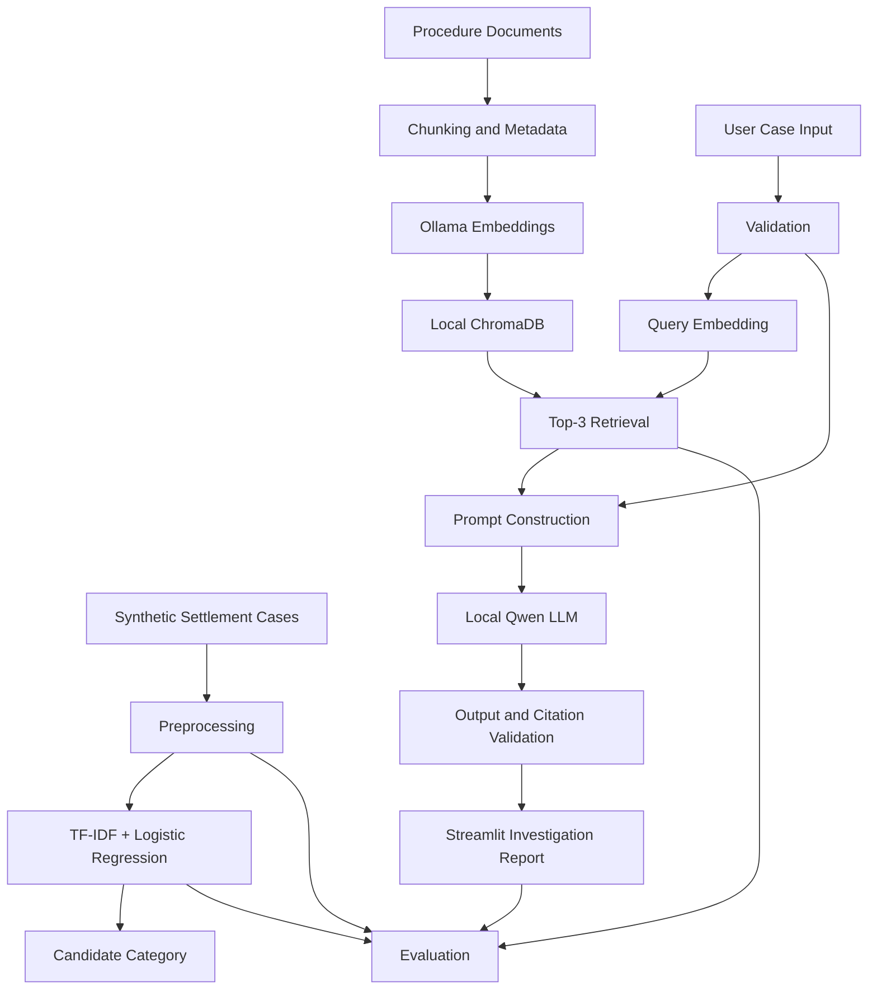

# SettleSense: Offline LLM-Based Securities Settlement Exception Investigation Copilot

SettleSense is an offline, local-first artificial intelligence copilot designed to support securities settlement operations analysts in investigating trade exceptions. The system integrates traditional Natural Language Processing (TF-IDF + Logistic Regression), local semantic vector retrieval (ChromaDB + `nomic-embed-text`), and local LLM reasoning (`qwen3:4b` via Ollama) to produce structured, citation-grounded investigation reports.

---

## Key Features

1. **100% Offline & Local**: Zero external API calls, paid cloud services, or hosted vector stores. All inferences and embeddings run on local hardware.
2. **Dual-Engine Investigation**: Combines a fast, lightweight supervised NLP classifier with a Retrieval-Augmented Generation (RAG) pipeline.
3. **Structured Pydantic Reports**: Guaranteed JSON schemas providing case summaries, supporting evidence, possible causes, recommended verification checks, missing information flags, and human escalation triggers.
4. **Citation & Hallucination Guardrails**: Cross-references every procedure citation against known illustrative procedure documents in the local knowledge base.
5. **Scenario-Leakage Prevention**: Built on a reproducible synthetic dataset partitioned using scenario-family grouping to prevent test data leakage.
6. **Graceful Degradation**: If Ollama or the local LLM is temporarily unavailable, the system displays operational warnings and continues to provide classifier predictions.

---

## Architecture Overview



---

## Prerequisites

1. **Python**: Version 3.11+ (Python 3.14 verified).
2. **Ollama**: Installed and running locally (`http://localhost:11434`).
3. **Ollama Models**:
   - Generation: `qwen3:4b` (`ollama pull qwen3:4b`)
   - Embeddings: `nomic-embed-text` (`ollama pull nomic-embed-text`)

---

## Installation & Setup

1. **Clone or navigate to the workspace**:
   ```bash
   cd /path/to/SettleSense
   ```

2. **Create and activate a virtual environment**:
   ```bash
   python3 -m venv .venv
   source .venv/bin/activate
   ```

3. **Install dependencies**:
   ```bash
   pip install -r requirements.txt
   ```

4. **Verify local Ollama service and models**:
   ```bash
   ollama list
   ```
   Ensure `qwen3:4b` and `nomic-embed-text` are present.

---

## Step-by-Step Workflow

### 1. Generate Synthetic Dataset
Generate 210 labelled exception cases and 30 ambiguous cases using deterministic seed 42:
```bash
python scripts/generate_dataset.py
```

### 2. Train Traditional Classifier
Train the TF-IDF + Logistic Regression model and output baseline metrics:
```bash
python src/train_classifier.py
```

### 3. Build Vector Index
Index illustrative procedure documents from `knowledge_base/` into ChromaDB using `nomic-embed-text`:
```bash
python scripts/build_index.py
```

### 4. Run Comparative Experiments
Run all four approaches (Classifier, Lexical, Prompt-Only, and Semantic RAG) and generate performance charts:
```bash
python scripts/run_experiments.py
```

### 5. Launch User Interface
Start the Streamlit operations dashboard:
```bash
streamlit run app.py
```

### 6. Run Test Suite
Execute the pytest suite:
```bash
pytest -v
```

---

## Project Structure

```text
SettleSense/
├── app.py                     # Streamlit web application
├── requirements.txt           # Project dependencies
├── README.md                  # System documentation and setup guide
├── .gitignore                 # Git ignore rules for ML and local artifacts
├── .env.example               # Example local environment configuration
├── config/
│   └── settings.py            # Global paths, model tags, and taxonomy constants
├── data/                      # Synthetic settlement exception datasets
├── knowledge_base/            # Illustrative procedure documents (PROC_01 to PROC_14)
├── src/                       # Core system library
│   ├── data_generator.py      # Deterministic dataset generation
│   ├── data_validation.py     # Schema and leakage validation
│   ├── preprocessing.py       # Text normalization and tokenization
│   ├── train_classifier.py    # TF-IDF + Logistic Regression training
│   ├── lexical_retrieval.py   # TF-IDF cosine similarity search
│   ├── embedding_index.py     # ChromaDB vector index builder
│   ├── semantic_retrieval.py  # Dense vector retrieval via nomic-embed-text
│   ├── ollama_client.py       # Resilient HTTP client for local Ollama
│   ├── rag_pipeline.py        # Prompt-only and RAG generation workflows
│   ├── output_schemas.py      # Pydantic schemas for structured reports
│   ├── output_validation.py   # Citation verification and schema validation
│   └── evaluation.py          # Metrics computation and visualization
├── scripts/                   # CLI execution scripts
├── tests/                     # Unit and integration tests
├── models/                    # Saved classifier and vectorizer artifacts
├── vector_store/              # ChromaDB persistent store
├── results/                   # Metric tables and comparative plots
└── docs/                      # Technical documentation and audit logs
```

---

## Operational Notice & Educational Disclaimer

> **Important**: SettleSense is an educational prototype and conceptual demonstration. All trade narratives, counterparty identifiers, account numbers, and procedure documents are entirely synthetic. The system does not connect to live financial networks and must never be used to execute financial transactions or autonomously amend settlement instructions. All recommendations require verification by a qualified operations analyst.

