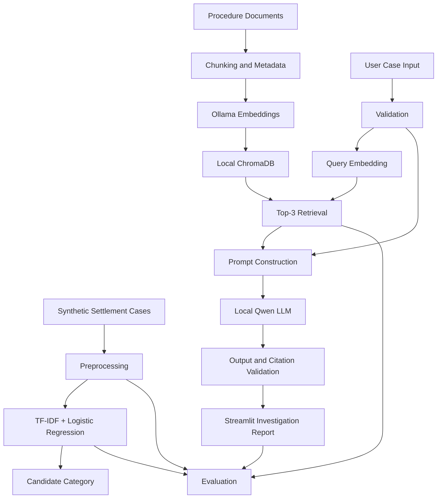

# SettleSense System Architecture

## 1. System Purpose & Boundaries
SettleSense is an offline, local-first artificial intelligence copilot designed to assist operations analysts in investigating securities settlement exceptions. 
The system operates entirely on local compute, utilizing local embeddings (`nomic-embed-text`) and a local language model (`qwen3:4b`) hosted via Ollama, along with local vector storage (ChromaDB) and scikit-learn NLP classifiers.

### Educational & Operational Boundaries
- Educational prototype using synthetic datasets and illustrative procedure references.
- No live connection to SWIFT, DTCC, Euroclear, custodian systems, or market infrastructure.
- Zero external network dependencies: no cloud LLMs, paid APIs, or hosted vector stores.
- The copilot generates investigation aids and recommendations; it strictly performs no autonomous operational actions, amendments, or payments.

## 2. High-Level Architecture Diagram

## 3. Core Modules & Pipelines

### 3.1 Data Ingestion & Validation
- **Module:** `src/data_generator.py`, `src/data_validation.py`
- Generates 240 deterministic cases (seed 42): 210 categorized across 6 canonical failure classes (35 per class) and 30 ambiguous (`UNDETERMINED`) cases.
- Validates scenario-family groupings to prevent data leakage between training and testing partitions.

### 3.2 Approach A: Supervised Classification Baseline
- **Module:** `src/preprocessing.py`, `src/train_classifier.py`
- Standardizes narratives (tokenization, lowercasing, stop-word removal).
- Extracts unigram and bigram TF-IDF representations.
- Trains a Logistic Regression multiclass classifier with group-aware cross-validation across scenario families.

### 3.3 Approach B: Lexical Retrieval Baseline
- **Module:** `src/lexical_retrieval.py`
- Indexes procedure documents using TF-IDF.
- Retrieves Top-3 relevant procedures based on cosine similarity against the input case narrative.

### 3.4 Approach C: Prompt-Only Local LLM
- **Module:** `src/rag_pipeline.py` (Prompt-only mode)
- Evaluates zero-shot reasoning capability of local `qwen3:4b` using only case facts without procedure retrieval.

### 3.5 Approach D: Local Semantic Retrieval-Augmented Generation (RAG)
- **Module:** `src/semantic_retrieval.py`, `src/embedding_index.py`, `src/rag_pipeline.py`
- Uses `nomic-embed-text` via Ollama to generate 768-dimensional dense vectors for procedure documents.
- Stores passages with metadata (procedure ID, title, category, source type) in local persistent ChromaDB.
- Retrieves Top-3 most similar procedure passages at inference time.
- Assembles grounded context into a constrained investigation prompt sent to `qwen3:4b`.

### 3.6 Output Schema & Citation Validation
- **Module:** `src/output_schemas.py`, `src/output_validation.py`
- Pydantic schema enforcing structured JSON output: `case_summary`, `candidate_failure_category`, `supporting_evidence`, `possible_causes`, `recommended_checks`, `missing_information`, `procedure_references`, `requires_human_review`.
- Verifies that cited procedure IDs correspond strictly to known procedures in the knowledge base.
- Flags hallucinated references or unsupported assertions.

### 3.7 Analyst Interface
- **Module:** `app.py` (Streamlit)
- Interactive dashboard enabling manual narrative entry, synthetic attribute customization, and pre-loaded case selection.
- Displays candidate classification, retrieved evidence passages, structured report, and model operational health.

